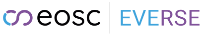
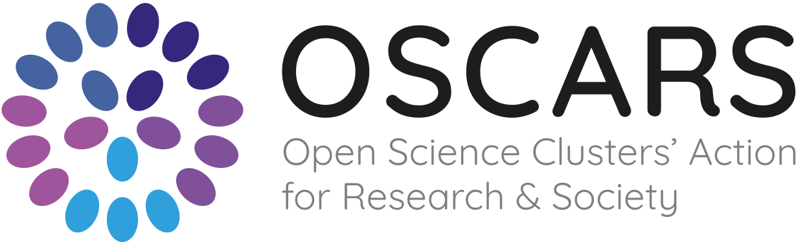

  

    
  

  

    <h1>Comment améliorer la qualité logicielle en pratique dans une communauté</h1>
    
Création d'un catalogue de logiciels au LAPP

  

  

    
<strong>Tom François</strong>

  

  

    
    
  

  

    
    
    
    
  

---
layout: image
image: ./binaries/schemas/intro_schema.svg
backgroundSize: 50em 90%
---

# Introduction

<!-- 
Dans cette présentation je vais parler de qualité logicielle.
Après une définition rapide, on va parler d'outils qui ont été développés dans les projets EVERSE et Codemetasoft.
Et comment s'en servir de briques pour d'autres projets.

-->

---

# Notre question, et 4 leviers

**Comment améliorer la qualité logicielle dans une communauté ?**

<v-clicks>

1. **Fixer des exigences partagées**
2. **Automatiser** et réduire la friction
3. Donner de la **visibilité** et une incitation
4. **Mesurer** et suivre dans le temps

</v-clicks>

Plan : qualité logicielle → outils (EVERSE, Codemetasoft) → applications (OSSR, CLLAPP) → retour sur les leviers

<!--
On annonce les leviers maintenant, on y reviendra en conclusion.
Sur les slides suivantes, un petit badge rappelle le levier illustré.
-->

---

### C'est quoi un logiciel de recherche ?

spectre plus ou moins inclusif:
- tendance à voir uniquement le code intégré dans le processus de la découverte scientifique
- on peut aussi considérer tout code qui a été utilisé/produit ou lié au processus de recherche dans un plusieurs étapes de cycle de vie de la recherche. 
	- code pour interfacer des détecteurs ou des logiciels qui sont sortis de l'exclusivité du monde de la recherche.

> Aleksandra Nenadic, Daniel Garijo, Laura Portell-Silva, Shoaib Sufi, "_What is Research Software?_". everse.software. [http://everse.software/RSQKit/research_software](http://everse.software/RSQKit/research_software) (accessed 20 November 2026).

<v-click>

### Différents tiers

- Analysis code : scripts d'analyse, jupyter notebook, support de publication
- Prototype tools : utilisation plus grande qu'une unique publication. Ex: agnpy, Compas Toolkit, ...
- Research Software infrastructure : gammapy, jupyter notebooks, scikit-learn, ...

> Aleksandra Nenadic, Daniel Garijo, Fotis Psomopoulos, Shoaib Sufi, "Three-Tier Model of Research Software". everse.software. http://everse.software/RSQKit/three_tier_view (accessed 20 November 2026). 

</v-click>

---

### La qualité logicielle : un concept multidimensionnel

<table class="w-full text-[10px] leading-[1.22] border-separate border-spacing-y-0.5">
  <thead>
    <tr class="text-left">
      <th class="w-[31%] px-2 py-1.5 text-[11px] bg-slate-100 rounded-l-lg">Dimension</th>
      <th class="px-2 py-1.5 text-[10px] bg-slate-100 rounded-r-lg">Description synthétique</th>
    </tr>
  </thead>
  <tbody>
    <tr><td class="px-2 py-1 font-semibold text-[12px] align-top">Community</td><td class="px-2 py-1">Santé des relations entre contributeurs, utilisateurs et parties prenantes.</td></tr>
    <tr><td class="px-2 py-1 font-semibold text-[12px] align-top">Compatibility</td><td class="px-2 py-1">Coexistence avec d’autres produits et échange ou réutilisation d’informations.</td></tr>
    <tr><td class="px-2 py-1 font-semibold text-[12px] align-top">FAIRness</td><td class="px-2 py-1">Adhésion aux principes Findable, Accessible, Interoperable et Reusable.</td></tr>
    <tr><td class="px-2 py-1 font-semibold text-[12px] align-top">Flexibility</td><td class="px-2 py-1">Adaptation à de nouveaux besoins, environnements ou charges de travail.</td></tr>
    <tr><td class="px-2 py-1 font-semibold text-[12px] align-top">Functional Suitability</td><td class="px-2 py-1">Fonctions complètes, exactes et adaptées aux tâches visées.</td></tr>
    <tr><td class="px-2 py-1 font-semibold text-[12px] align-top">Interaction Capability</td><td class="px-2 py-1">Interface facile à apprendre, à utiliser, inclusive et prévenant les erreurs.</td></tr>
    <tr><td class="px-2 py-1 font-semibold text-[12px] align-top">Maintainability</td><td class="px-2 py-1">Modifications efficaces grâce à la modularité, les tests et la réutilisabilité.</td></tr>
  </tbody>
</table>

<table class="w-full text-[10px] leading-[1.22] border-separate border-spacing-y-0.5">
  <thead>
    <tr class="text-left">
      <th class="w-[31%] px-2 py-1.5 text-[11px] bg-slate-100 rounded-l-lg">Dimension</th>
      <th class="px-2 py-1.5 text-[10px] bg-slate-100 rounded-r-lg">Description synthétique</th>
    </tr>
  </thead>
  <tbody>
    <tr><td class="px-2 py-1 font-semibold text-[12px] align-top">Open Source Software</td><td class="px-2 py-1">Code accessible pour inspection, modification, vérification et contribution.</td></tr>
    <tr><td class="px-2 py-1 font-semibold text-[12px] align-top">Performance Efficiency</td><td class="px-2 py-1">Délais, débits et charge respectés avec une utilisation efficace des ressources.</td></tr>
    <tr><td class="px-2 py-1 font-semibold text-[12px] align-top">Reliability</td><td class="px-2 py-1">Fonctionnement prévu, disponibilité, tolérance aux fautes et reprise après panne.</td></tr>
    <tr><td class="px-2 py-1 font-semibold text-[12px] align-top">Safety</td><td class="px-2 py-1">Prévention des situations dangereuses pour les personnes, les biens ou l’environnement.</td></tr>
    <tr><td class="px-2 py-1 font-semibold text-[12px] align-top">Security</td><td class="px-2 py-1">Protection contre les attaques et contrôle des données : accès, intégrité et authenticité.</td></tr>
    <tr><td class="px-2 py-1 font-semibold text-[12px] align-top">Sustainability</td><td class="px-2 py-1">Disponibilité durable sur de nouvelles plateformes et pour de nouveaux besoins.</td></tr>
  </tbody>
</table>

Source : EVERSE, « Research Software Quality and Project Health Dimensions ».

---

# Par où commencer dans une communauté ?

Trois critères pour choisir un point d’entrée :

<v-clicks>

- **Mesurable automatiquement** : pas de relecture manuelle à grande échelle
- **Utile à tous** : lisible par les services de découverte (catalogues, dépôts, moteurs de recherche)
- **Peu coûteux** pour les auteurs de logiciels

</v-clicks>

<v-click>

**→ Les métadonnées répondent aux trois critères.**

</v-click>

> 🖼️ **Schéma** : 3 critères qui convergent vers une pastille « métadonnées ».

<!--
Cette slide justifie le zoom sur Codemetasoft, et plus largement le choix des outils d’EVERSE.
-->

---

# EVERSE : ne pas tout recréer

Projet européen qui construit et combine des **outils et ressources** pour la qualité du logiciel de recherche.

- Principe : **utiliser l’existant** et améliorer son utilisabilité
- https://everse.software/

> 🖼️ **Illustration** : logo EVERSE, entouré des logos d’outils existants qui s’assemblent comme un puzzle.

---

# Les briques d’EVERSE

- **RSQKit** : ressources pédagogiques
- **TechRadar** : catalogue d’outils, catégorisés par dimension de la qualité
- **resqui** : paquet Python qui évalue un logiciel en combinant de nombreux plugins existants
- **dashverse** : dashboard de présentation des analyses produites par resqui

> 🖼️ **Schéma** : chaîne horizontale en 4 blocs **Apprendre → Choisir → Évaluer → Présenter** (RSQKit → TechRadar → resqui → dashverse), avec une capture d’écran sous chaque bloc.

Levier ④ Mesurer

<!--
Si le temps manque, se concentrer sur resqui et dashverse, qui reviennent dans OSSR et CLLAPP.
-->

---

# Les métadonnées : petites, mais décisives

Elles décrivent le logiciel : **licence, langage, date de modification, mots-clés**…

<v-clicks>

- Souvent **oubliées**, ou **non maintenues**
- Pourtant c’est **le premier élément lu** par les services
- → **FAIR** : Findable, Accessible, Interoperable, Reusable

</v-clicks>

> 🖼️ **Schéma** : à gauche un extrait de `codemeta.json`, à droite des flèches vers les « lecteurs » (catalogues, dépôts, moteurs de recherche).

<!--
Site du projet : https://softwareunderstanding.github.io/CodeMetaSoft_website/website/
-->

---

# Codemetasoft : créer, analyser, maintenir

Des outils pour **faciliter l’usage des métadonnées et automatiser leur maintien** :

- **autocodemeta** : assistant de création de `codemeta.json`
- **rsmetacheck** : analyse des métadonnées
- **rsmetacheck-bot** : lance l’analyse et la soumet sous forme d’issues sur la forge

> 🖼️ **Schéma** : cycle **Créer → Analyser → Signaler (issue) → Corriger → Créer…**, avec le nom de l’outil sur chaque flèche.

Levier ② Automatiser

---

# rsmetacheck-bot en pratique

> 🖼️ **Capture d’écran** : une issue ouverte automatiquement sur un dépôt réel, avec les points détectés (pitfalls et warnings). Annoter 1 ou 2 éléments.

Levier ② Automatiser · ④ Mesurer

<!--
Exemple concret : l’auteur n’a rien à lancer, l’information arrive là où il travaille déjà.
-->

---

# Des briques aux applications

On réutilise l’existant, comme le préconise EVERSE :

| Brique | OSSR | CLLAPP |
|---|---|---|
| autocodemeta | ? | ✅ génération du codemeta |
| rsmetacheck / bot | pas encore utilisé | pas encore utilisé |
| resqui | 🔜 curation + suivi | 🚧 quality pipeline |
| dashboard (dashverse) | 🔜 qualité du catalogue | ? |

✅ en place · 🚧 en cours · 🔜 prévu

<!--
Les « ? » sont à compléter. Les icônes ou logos des outils seront repris sur les slides OSSR et CLLAPP.
-->

---

# ESCAPE OSSR : un catalogue pour une communauté

**Open Source Software Repository** : catalogue de dépôts dédié aux communautés d’astro et de physique des particules, hébergé sur Zenodo.

- But : regrouper les logiciels d’un même domaine, **avec des exigences de qualité**
- https://escape-ossr.gitlab.io/ossr-pages/
- Communauté Zenodo : https://zenodo.org/communities/escape2020

> 🖼️ **Capture d’écran** : page d’accueil du catalogue OSSR et liste des enregistrements de la communauté Zenodo.

Levier ① Exigences partagées

---

# OSSR : le fonctionnement actuel

La curation analyse le dépôt Zenodo et vérifie les critères requis. Le résultat est reporté dans une **merge request** dédiée, **validée manuellement** par le board ESCAPE.

> 🖼️ **Schéma** : flux horizontal **Dépôt Zenodo → Analyse des critères → Merge request de curation → Validation manuelle (board ESCAPE) → Entrée dans le catalogue**. Mettre en évidence l’étape manuelle.

Levier ① Exigences partagées

---

# OSSR : limites et prochaines étapes

### Limites

- Validation manuelle
- Pas de suivi de la qualité dans la durée

### Prochaines étapes

- Ajouter **resqui** pour la curation et le suivi des projets ajoutés
- Créer un **dashboard** de suivi de la qualité du catalogue

> 🖼️ **Schéma** : même flux que la slide précédente, avec en couleur différente (pointillés) les ajouts prévus : resqui dans l’analyse, dashboard en sortie. Légende existant / prévu.

Levier ④ Mesurer · ③ Visibilité

<!--
Les limites justifient les prochaines étapes : c’est l’articulation à faire entendre.
-->

---

# CLLAPP : le catalogue de logiciels du LAPP

Projet très récent : voici les premières étapes.

<v-clicks>

- Les logiciels du laboratoire ne sont pas forcément mis en avant lors des évaluations : ils apparaissent surtout s’ils sont associés à des publications
- Les projets informatiques sont mal connus au sein du laboratoire → **favoriser la collaboration**
- Mettre en place des **outils de qualité logicielle** sur ces dépôts

</v-clicks>

> 🖼️ **Illustration** (facultative) : trois icônes, une par motivation (évaluation, collaboration, qualité).

Levier ③ Visibilité

---

# CLLAPP : ce qui existe aujourd’hui (POC)

L’utilisateur **ajoute l’url d’un dépôt** :

<v-clicks>

1. le `codemeta.json` est **généré** à partir de l’url
2. il est **ajouté à la base de données**
3. il apparaît dans le **catalogue**

</v-clicks>

> 🖼️ **Capture d’écran** : formulaire d’ajout d’une url, puis l’entrée apparue dans le catalogue (webview).

Levier ② Automatiser · ③ Visibilité

---

# CLLAPP : la vision cible

> 🖼️ **Schéma** : pipeline de création et maintien du catalogue, avec **code couleur** :
> - 🟩 **existe** : url de dépôt → génération du codemeta → base de données de codemeta → catalogue (webview) ;
> - 🟧 **en cours**, bords en pointillés : url de groupe/propriétaire → sélection des dépôts, mise à jour des codemeta, quality pipeline → évaluations de qualité (affichées dans le catalogue).
>
> Légende en bas à droite.

<!--
Ce qui est vert existe déjà : ajout d’une url, génération du codemeta, ajout en base et dans le catalogue. Le reste est en cours de développement.
-->

---

# Retour sur la question : 4 leviers

| Levier | Outils | Applications |
|---|---|---|
| ① Exigences partagées | TechRadar, resqui | OSSR (curation) |
| ② Automatiser | autocodemeta, rsmetacheck-bot | CLLAPP (génération des codemeta) |
| ③ Visibilité | dashverse | CLLAPP (catalogue), OSSR |
| ④ Mesurer | resqui, rsmetacheck | OSSR (prévu), CLLAPP (en cours) : suivi dans la durée |

<!--
Reprendre les 4 leviers de l’intro : la question du titre trouve sa réponse ici.
-->

---

# Perspectives

- **Catalogue de domaine** : généraliser le modèle OSSR à d’autres communautés
- **Catalogue de laboratoire** : étendre CLLAPP à l’**IN2P3**, pour renforcer la collaboration et la réutilisation d’outils entre laboratoires
- Qui veut tester ou contribuer ?

> 🖼️ **Schéma** : du LAPP vers plusieurs laboratoires IN2P3 reliés autour d’un catalogue commun.

---
layout: center
class: text-center
---

# Questions ?

Tom François · LAPP

EVERSE : https://everse.software/ · Codemetasoft : https://softwareunderstanding.github.io/CodeMetaSoft_website/website/ · OSSR : https://escape-ossr.gitlab.io/ossr-pages/

<!--
5 min prévues pour les questions.
-->